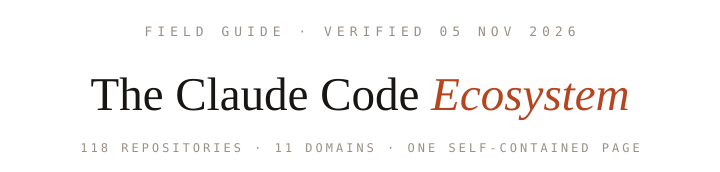
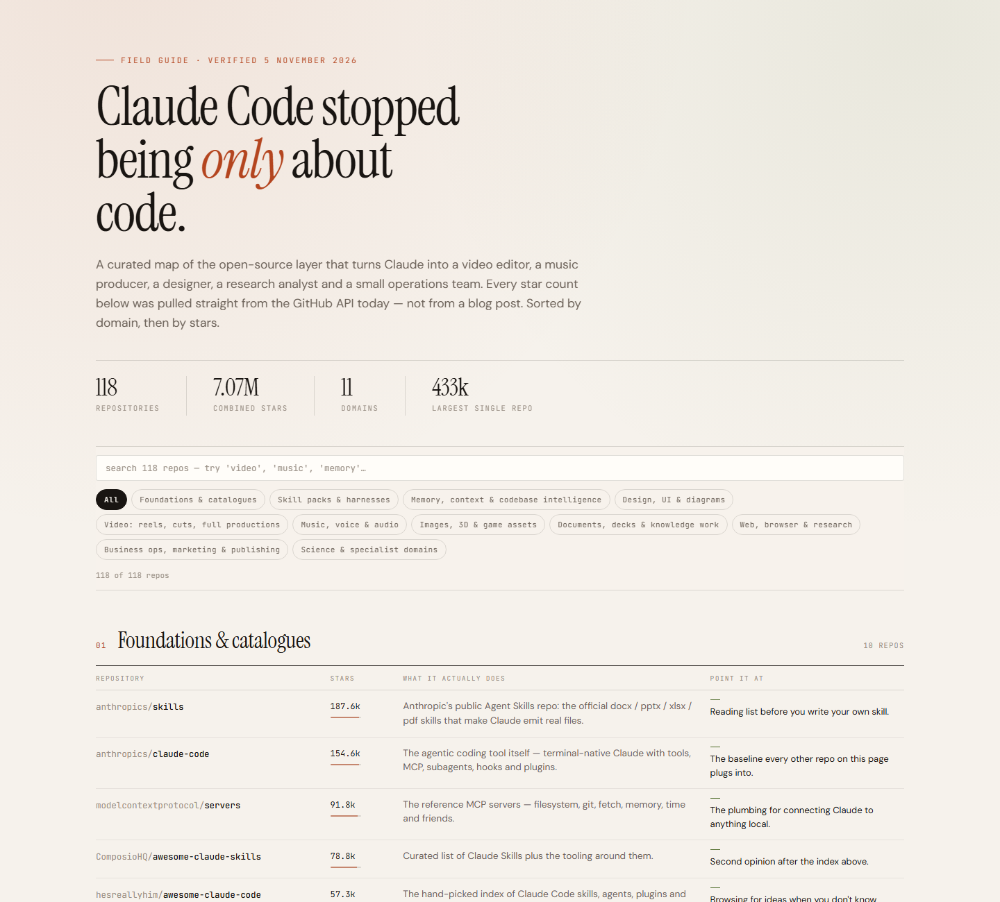
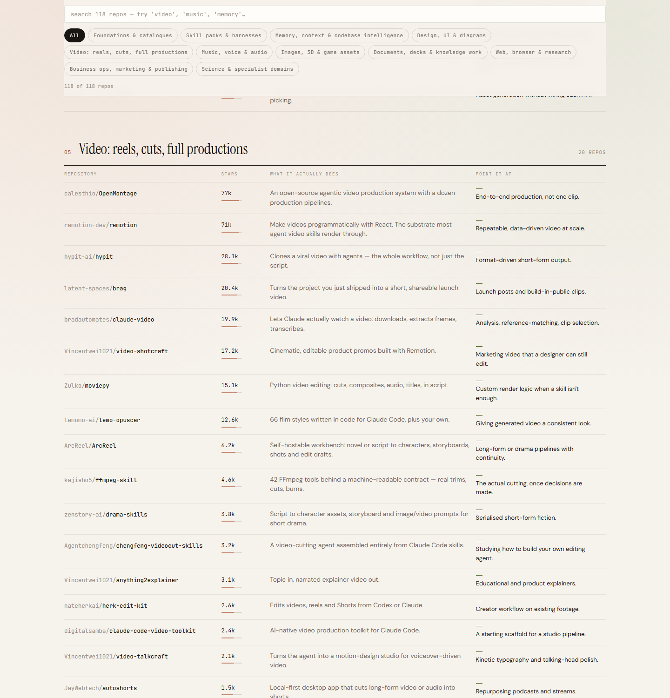
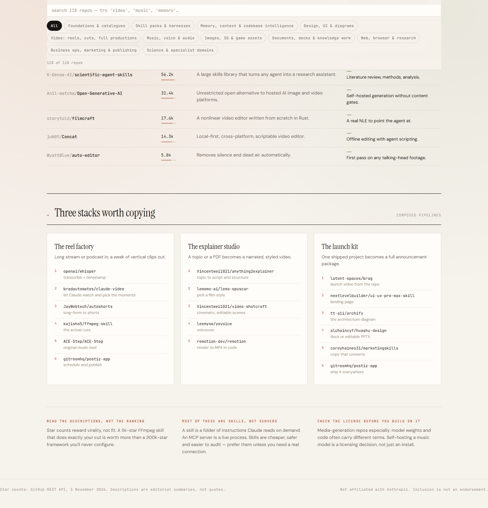

<p align="center">
  <picture>
    <source media="(prefers-color-scheme: dark)" srcset="docs/assets/lockup-dark.svg" />
    
  </picture>
</p>
<h3 align="center">A field guide to what people actually built around Claude Code.</h3>

<p align="center">
  <picture>
    <source media="(prefers-color-scheme: dark)" srcset="docs/assets/guide-hero-dark.png" />
    
  </picture>
</p>

<p align="center"><strong>Official channels:</strong> <a href="https://ravaniroshan.github.io/claude-code-ecosystem-guide/">Live site</a> · <a href="https://github.com/RavaniRoshan/claude-code-ecosystem-guide">GitHub</a><br/>The guide is free to read, share and fork. Not affiliated with Anthropic. Inclusion is not an endorsement. <a href="#notices">Details →</a></p>

<p align="center"><sub>If this guide saved you an afternoon of searching, <a href="https://github.com/RavaniRoshan/claude-code-ecosystem-guide/stargazers">a ⭐</a> is what keeps it refreshed.</sub></p>

<p align="center">Start with a job you didn't know agents could do: cut a podcast into reels, score it with original music, diagram an architecture, run a research brief. This page maps <strong>118 open-source repositories</strong> across <strong>11 domains</strong> that turn Claude — and agent harnesses like it — into a video editor, a music producer, a designer and a small operations team.</p>

<p align="center">
  <a href="https://ravaniroshan.github.io/claude-code-ecosystem-guide/"><strong>Open the guide</strong></a> &nbsp;·&nbsp;
  <a href="#quick-start"><strong>Get started</strong></a> &nbsp;·&nbsp;
  <a href="#three-stacks-worth-copying"><strong>Recipes</strong></a> &nbsp;·&nbsp;
  <a href="#data--methodology"><strong>How the data was collected</strong></a> &nbsp;·&nbsp;
  <a href="#contributing"><strong>Submit a repo</strong></a>
</p>

<p align="center">
  <a href="https://github.com/RavaniRoshan/claude-code-ecosystem-guide/stargazers"></a>
  <a href="#whats-inside"></a>
  <a href="#whats-inside"></a>
  <a href="#data--methodology"></a>
  <a href="#quick-start"></a>
</p>

<p align="center">
  <a href="https://ravaniroshan.github.io/claude-code-ecosystem-guide/"></a>
  <a href="https://github.com/RavaniRoshan/claude-code-ecosystem-guide/issues/new?title=%5Bsubmission%5D%20Add%20a%20repo"></a>
</p>

## See the guide in action

**One page. 118 repos, sorted, annotated, searchable.** The hero already shows the shape of it: domain tables below a sticky filter bar, a count that updates as you type, and stars with bar-glyphs scaled against the largest repo on the page.

- **Live search and domain chips.** Type `video`, `memory` or `MCP` and the page re-filters instantly — every row updates, empty domains collapse, the counter follows.
- **Editorial two-liners, not market copy.** Each repository gets *"what it actually does"* and *"point it at"* — 120 characters of truth instead of a landing page.
- **Honest ranking signals.** Rows are sorted by stars, but the sidebar notes tell you why a 5k-star skill may beat a 300k-star framework for your exact job.

<a id="whats-inside"></a>

## What's inside

| Look up any domain | Steal a proven stack |
|---|---|
| <picture><source media="(prefers-color-scheme: dark)" srcset="docs/assets/guide-video-dark.png" /></picture> | <picture><source media="(prefers-color-scheme: dark)" srcset="docs/assets/guide-recipes-dark.png" /></picture> |
| 20 video repositories, from end-to-end agentic production pipelines down to a guardrailed FFmpeg MCP that can't destroy your source. | Three ready-made pipelines — the reel factory, the explainer studio and the launch kit — with every step wired to a real repo. |

The 11 domains: **Foundations & catalogues** · **Skill packs & harnesses** · **Memory, context & codebase intelligence** · **Design, UI & diagrams** · **Video: reels, cuts, full productions** · **Music, voice & audio** · **Images, 3D & game assets** · **Documents, decks & knowledge work** · **Web, browser & research** · **Business ops, marketing & publishing** · **Science & specialist domains**

Headline numbers, pulled straight from the GitHub REST API on **5 November 2026**:

| | |
|---|---|
| **118** | repositories curated across every domain |
| **7.07M** | combined stars |
| **433k** | stars of the largest single repo |
| **0** | external dependencies — one HTML file that runs entirely client-side |

<a id="quick-start"></a>

## Quick start

### 1. Open it

It's hosted — no setup at all:

> **https://ravaniroshan.github.io/claude-code-ecosystem-guide/**

### 2. Or run it locally

The guide is a single self-contained file:

```bash
# Windows
start index.html

# macOS / Linux
open index.html

# or serve it
python -m http.server 8000
```

### 3. Use the stack recipes

Scroll to **Three stacks worth copying** and follow the composed pipelines. Pick the repo that matches your task, install it the way its README suggests (a skill goes into `.claude/skills/`, an MCP server into your harness config), and chain steps as you would a macro.

## Three stacks worth copying

| Stack | Entry point | Chain |
|---|---|---|
| **The reel factory** | A long stream or podcast in | `whisper` → `claude-video` → `autoshorts` → `ffmpeg-skill` → `ACE-Step` → `postiz-app` |
| **The explainer studio** | A topic or a PDF in | `anything2explainer` → `lemo-opuscar` → `video-shotcraft` → `yovoice` → `remotion` |
| **The launch kit** | One shipped project in | `brag` → `ui-ux-pro-max-skill` → `archify` → `huashu-design` → `marketingskills` → `postiz-app` |

Each chain is fully annotated on the live page, with a link to every repo.

<a id="data--methodology"></a>

## Data & methodology

<details>
<summary>Where the numbers come from, and how to refresh them</summary>

- **Star counts** were pulled from the GitHub REST API on **5 November 2026** and typed into the page as a snapshot. Star counts drift daily — treat the numbers as a verification date, not a live ranking.
- **Descriptions** are editorial summaries written for this guide; they are deliberately not the projects' own taglines.
- **Ordering** inside each domain is stars, descending. Within ~1k stars the order can be stale within weeks.
- **Refresh arithmetic**: open [`index.html`](https://github.com/RavaniRoshan/claude-code-ecosystem-guide/blob/main/index.html), update each `<span class="num">` star value and bar width, adjust the four hero stats and the footer's date note, and deploy. Bar widths scale against the page maximum (433k).
- **Selection bias**: repos were picked for working product surface and credible maintenance — not by popularity alone. Tell us about a repo that belongs in the tables in [issues](https://github.com/RavaniRoshan/claude-code-ecosystem-guide/issues/new?title=%5Bsubmission%5D%20Add%20a%20repo).

</details>

<a id="contributing"></a>

## Contributing

PRs and issues are equally welcome.

- **Add a repo**: append a `<tr>` to the correct domain table in `index.html`, with a two-column description and `use` labels, keeping the star order. Update the domain's `dcount` line and the hero stats if affected.
- **Refresh star counts**: see [Data & methodology](#data--methodology). Set a new verified date in the kicker and footer.
- **Fix a description**: open a PR with wording that stays in the guide's voice — one sentence for what it does, one for who should reach for it.
- **Report a dead repo**: the repo was deleted, renamed or went private — raise an issue or edit a row.

## Notices

- **Not affiliated with Anthropic.** *Claude Code* and *Page* content refer to `anthropics/claude-code` and the ecosystem around it; this field guide is an independent, community-curated index. Inclusion is not an endorsement by Anthropic or the maintainer.
- **Check the license before building on any listed repo.** Media-generation repos especially: model weights and code often carry different licensing terms. Self-hosting a music model is a licensing decision, not just an install.
- Star counts are snapshots, and GitHub profile links may change as repositories rename. Report inaccuracies via [issues](https://github.com/RavaniRoshan/claude-code-ecosystem-guide/issues).

## Star History

<p align="center"><picture><source media="(prefers-color-scheme: dark)" srcset="https://api.star-history.com/svg?repos=RavaniRoshan/claude-code-ecosystem-guide&type=Date&theme=dark" /></picture></p>
